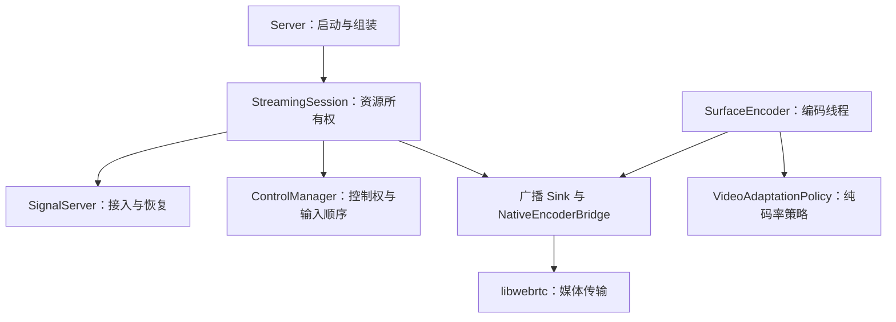

# 云手机串流架构

本文描述本次重构后的实际代码。此前 `streaming-fixes.md`、`weak-network-recovery.md` 中的历史行为，
与本文不一致时，以本文及协议 v3 为准。目标是让生命周期、线程、策略和设备适配各有一个明确的责任主体。

## 业务边界

一个 Android 服务实例对应一台云手机的一个授权房间。共享一条采集/编码管线，允许有限数量的观看者，
同一时刻只有一个控制者。该进程不是多租户调度服务，也不承担计费、设备租赁或账号管理。
这些能力应由外部控制平面管理，并通过受控网关接入。

采用模块化单体，避免把每一层拆成网络服务。需要横向扩展的是云手机实例和边缘媒体基础设施，
不是把一次触屏操作在多个业务服务间转发。

## 组件与依赖



| 组件 | 责任 | 不应承担 |
|---|---|---|
| `Server` | 选择 TCP/WebRTC 路径，创建采集器、编码器、Controller，停止处理器 | 维护观看者 map、重连协议、码率聚合 |
| `StreamingConfig` | 校验部署参数，明确最大码率、房间、并发与音频策略 | 持有 socket、操作设备 |
| `StreamingSession` | 唯一拥有所有 Peer，组合广播、控制和信令；关闭全部 peer | 解析 WebSocket JSON、直接配置 MediaCodec |
| `PeerKey` | room/client 复合路由身份 | 认证凭证 |
| `SignalServer` | 串行处理接入、恢复、协商和到期；限制等待数量 | 决定画质、停止整个采集会话 |
| `PeerLease` | 独立恢复秘密、socket owner、恢复期限、页面身份 | 管理 Android 或 libwebrtc |
| `ControlManager` | 控制权排队、交接时释放旧输入、过滤非控制者 | 持有媒体 peer 的生命周期 |
| `BitrateAggregator` | 明确选择共享编码器预算的业务策略 | 再实现一个 GCC |
| `VideoAdaptationPolicy` | 纯 Java 的预算平滑、档位和配置上限 | 调用 MediaCodec/JNI |
| `SurfaceEncoder` | 在编码线程应用预算、重配、请求 IDR | 鉴权、房间和用户管理 |
| `BroadcastVideoSink` | 一个不可变 payload 扇出，新/重置 peer 等待参数集和 IDR | 随意丢弃已经编码的参考帧 |
| `NativeEncoderBridge` | JNI 边界和 native handle；同步调用期间明确 payload 所有权 | 控制业务会话生命周期 |
| H5 `ScrcpyClient` | PeerConnection、恢复协议、有限输入排队 | 保存首次登录凭证、推断服务端下行预算 |

WebRTC 关闭故障只报告到对应 Peer；采集不可恢复、控制队列溢出或监听启动失败才进入外层会话终止流程。
TCP scrcpy 路径继续使用原来的 `DesktopConnection` 和 `Streamer`。

## 所有权与关闭

- 没有通过接入校验前不创建 native peer；并发上限包含恢复宽限期中的 peer。
- 全部 peer 由 `StreamingSession` 管理，不再区分特殊的“主 bridge”和“附加 bridge”。
- 移除顺序：失效回调、移除音视频订阅、移除码率样本、释放控制权、关闭 native bridge。
- 全局停止：停止信令并回收其 peer，再关闭输入，最后由 `Server` 停止采集与编码并 join。
- 移除与整体 close 可重复调用。旧 bridge 回调不允许恢复已删除的预算或替换新 peer。
- 新 peer 首次刷新请求及首次正预算会合并到编码线程的采集刷新，以覆盖完全静止的屏幕；
  零预算后恢复也重新刷新。当前刷新可能重建共享采集/编码器，因此需测试其他观看者的瞬时停顿。
- 同一页面换 socket 不关闭媒体；新页面身份使用 native peer reset，保留共享采集器。
- 当前仍会在零观看者时保持采集处理器存在。按空闲时间挂起/释放采集属于设备验收后的进一步优化，
  不能把“没有 native peer”解释为“完全没有编码开销”。

## 线程规则

1. WebSocket 的 open/message/close 转交单个 `signaling` executor；协议 map 和恢复租约只在该线程访问。
2. 协商和连接回调提交回该 executor，不在 native signaling 回调里持有 Java 协议锁。
3. 原生媒体回调只能更新有界状态、提交信令或更新编码反馈，不直接停止其他 peer。
4. MediaCodec 配置、动态码率和关键帧操作仅在编码线程执行。
5. 输入授权变更与设备输入入队使用同一把锁；旧输入释放标记排在新控制者输入之前。
6. 网络发送不在输入锁内执行；控制回包查找当前控制者。
7. fanout 共享只读 Java payload，JNI 调用仍为同步复制；不能在释放 MediaCodec buffer 后异步访问原缓冲。

`SignalServer` 最多排队 64 条待处理消息，接入最多 64 个 socket；每条信令最多 65536 个字符。
这些限制不能代替网关的连接速率、WebSocket 帧尺寸、TLS、鉴权和每账号配额限制。

## 接入与恢复协议 v3

初次接入：`join {token, room, clientId, peerId}`。
服务端校验房间和并发后返回 `ready {protocolVersion:3, clientId, roomId, resumeToken, resumed:false}`。
客户端收到 ready 后发送 offer/ICE。

- `clientId`：被接纳的逻辑观看者身份。
- `peerId`：本次页面的 PeerConnection 身份。
- `resumeToken`：服务端独立生成的 256-bit 恢复秘密。知道 clientId 不等于有权替换连接。
- 初次接入凭证只留在内存，不写 URL、日志或 sessionStorage。

信令中断时保留媒体，服务端给予 45 秒离线宽限；H5 在固定 30 秒恢复窗口内重试。
恢复请求为 `resume {token:resumeToken, room, clientId, peerId}`。
同一 peerId 保留媒体；不同 peerId 先释放旧控制权，再重建对应 native peer。
旧 socket 的关闭事件不能撤销新 owner。新的页面代次会使旧 Answer/ICE 回调失效。

同一页面恢复时，已发送且仍在等待回答的 offer 不被替换。服务端缓存最新回答，恢复后重发，
客户端忽略已应用的重复回答。媒体健康且没有待处理协商时，不为恢复 socket 额外发起 ICE restart。

`bye` 是明确终止，立即回收 peer。鉴权/协议拒绝是终止错误；普通 socket 中断才进入恢复。
H5 使用 tab 级 `sessionStorage` 保存有 45 秒滚动期限的恢复秘密、clientId、房间和端点。
新输入的登录凭证表示新接入，不会被旧恢复缓存静默替换。页面恢复则显式使用缓存。

当前登录凭证是房间级共享接入能力，不是每账号一次性票据。角色授权、票据签发/吊销、
设备租约归属应在控制平面与认证网关实现；需要不可信多租户接入时，必须先完成该集成。

## 共享码率策略

`bandwidth_policy=controller` 为默认值：有控制者时使用其预算；没有控制者时使用活跃观看者的最小正预算。
`bandwidth_policy=minimum` 保留所有活跃观看者取最小预算的策略。

控制者优先保证业务优先级，不保证弱观看者仍有流畅画质。单路 H.264 不能仅靠 SFU 或一个策略开关产生低码率版本。
差异化质量需要多档源流/可分层编码与接收订阅能力，再接 SFU。

编码策略提供最大边长 480/640 的 10/15fps 弱网档位，后接常规档位。WebRTC 启动使用最多
500kbps、640 最大边长、15fps，仍遵守用户尺寸/帧率上限；`video_bit_rate` 是自适应编码目标的上限。
升档采用基于时间的平滑与逐级稳定窗口，下降应用原始预算；SetRates 静默不是心跳超时。
编码目标不超过当前分配和运营上限；只平滑增加，降低预算立即生效。有效分配在零预算或 peer reset 前持续有效，
编码线程 tick 推进升速及档位防抖，不依赖 SetRates 心跳。held 是已保持的配置预算，不是实测/ACK 吞吐。
网络探测由 WebRTC ALR probing、pacer 和 transport feedback 完成，Java 不再通过 H.264 超发探测。
档位为 480/10、640/15、854/24、960/30、1280/30、1280/60、1600/60、1920/60；
最高档标称 6Mbps，配置尺寸/帧率及实际 MediaCodec 能力仍是上限。
Java 关键帧请求跨轮询至少相隔 300ms；native 合并未完成请求、成功提交当前 IDR 后满足请求，
检测到透传帧序号缺口/提交失败时停止转发依赖帧并请求 IDR，未完成恢复时最多每秒重试。
档位、平滑与关键帧间隔是初始策略参数，仍需目标 SoC、内容和网络标定。
隔离验证与构建边界见 [frame-rate-validation.md](frame-rate-validation.md)。

音频统一 PCM -> 10ms 分帧 -> libwebrtc 内置 Opus。删除外部 Opus 队列、伪 PCM 驱动和其自定义编码工厂。
WebRTC 模式拒绝 `audio_scheme=opus`；原 TCP 音频编码选项不变。

## 接入参数与升级

| 参数 | 默认/含义 |
|---|---|
| `signal_bind` | `127.0.0.1`，通过受控 WSS 代理对外服务 |
| `signal_token` | 生产模式至少 32 字符，实际应使用高熵随机秘密 |
| `signal_debug` | `false`；仅隔离调试时显式设 true 才允许空凭证 |
| `signal_room` | `default`；该实例唯一授权房间 |
| `max_peers` | 10，允许配置 1..64；它是准入上限，不是性能承诺 |
| `bandwidth_policy` | `controller`，或 `minimum` |
| `local_min_port/local_max_port` | 0/0 使用系统范围；显式指定时同时下传 native ICE 配置 |
| `public_ip/external_min_port/external_max_port` | 使用静态端口映射时配置；只改写 candidate 地址和端口字段 |
| `audio_scheme` | WebRTC 只支持 pcm |
| `video_bit_rate` | WebRTC 自适应目标上限，默认 8Mbps；不等于实际输出或总线路速率 |
| `video_adaptation` | 默认 true；false 固定用户尺寸/帧率用于诊断，仍遵守 WebRTC 码率预算和硬件能力；未指定帧率时用 30fps |

H5 只接受 WSS 或 localhost WS。删除固定公网调试地址；页面默认使用当前站点的 `/signal`。
使用静态 NAT 映射必须保证实际路由/防火墙与本地端口范围一致，改写 candidate 不会创建 NAT 映射。

本次 JNI `nativeCreate` 增加媒体端口参数，原生源码和 Java 桥均有变化。必须一起部署新 H5、新 JNI、新 APK。
JNI 在独立编译服务器构建，导出 `.so` 和 `native-build.json` 配套制品。APK 服务导入后，
Gradle 的 `prepareNativeLibrary` 只校验、不编译；不匹配时拒绝打包，合并库前再次核对哈希。详见 `native-build.md`。

```sh
# 编译服务器：使用匹配 libwebrtc revision 的工具链，按 native-build.md 准备材料
python3 server/tools/build_native.py
python3 server/tools/native_bundle.py export --output /path/to/scrcpy-native-arm64.zip
# APK 服务：传入编译服务器交付的制品，无需 native 工具链
python3 server/tools/native_bundle.py import /path/to/scrcpy-native-arm64.zip
./gradlew -p server test lint checkstyle assembleDebug
# 在 p4/web 内使用对应平台依赖
npm ci
npm run build
```

不要部署仓库中旧的 dist、APK 或 so 作为本次重构产物。

低码率、低帧率和指标波动的诊断及本次恢复修复见 [low-bitrate-diagnostics.md](low-bitrate-diagnostics.md)。

## 测试与阅读顺序

1. 先读 `Server.scrcpy()`，理解 TCP/WebRTC 组装分支。
2. 再读 `StreamingSession`，理解资源唯一所有权和 peer 退出。
3. 读 `PeerLease` / `SignalServer` 理解恢复与协商代次。
4. 读 `ControlManager` / `BitrateAggregator` 理解业务优先级。
5. 最后读 `VideoAdaptationPolicy` / `SurfaceEncoder` 和 JNI 媒体细节。

`python3 tests/run_regressions.py` 包括架构、纯 Java、原生媒体工具、H5 类型与 mock 行为回归。
`tests/run_architecture.py` 对实际会话/信令/控制/策略类运行行为测试，平台和 native transport 使用绑定替身。
它不证明真实编解码、SCTP、ICE、Android 权限、弱网延迟或容量。发布验收见 `commercial-readiness.md`。
